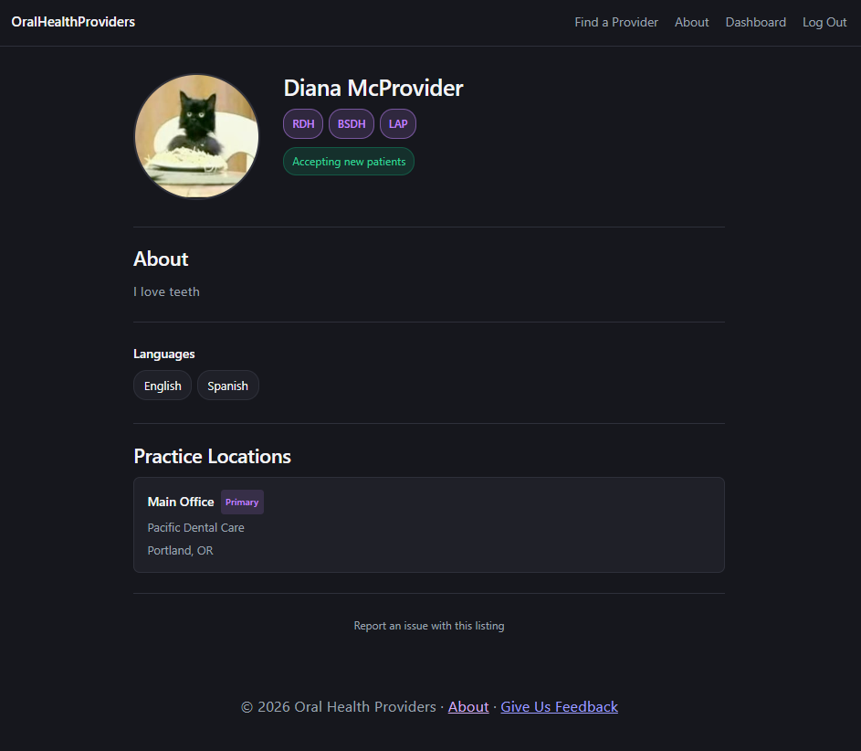

# FindMyHygienist

**A directory for Oregon's dental hygienists and other oral healthcare providers, built so the people who take care of your teeth can show you who they are.**

FindMyHygienist is modeled after [Psychology Today's therapist directory](https://www.psychologytoday.com/us/therapists) — a searchable, browsable listing where dental hygienists and other providers create profiles, share their credentials, and connect with patients who need them. Providers sign up, tell their story, and go live. Patients search by location or by what matters to them — "my kids are afraid of the dentist," "Spanish-speaking," "accepts OHP" — and browse profiles to find patient-centered care that makes them feel safe, respected, and cared for — the kind of care hygienists strive to provide but patients don’t always know how to find.

This is an Oregon-specific project in partnership with the [Oregon Dental Hygienists' Association](https://www.odha.org/) (ODHA). Free to list through July 2026. $15/month after that. Search is always free.



*Provider profile page — the surface providers will judge the product by at the conference.*

## Tech Stack

| Layer | Tool |
|-------|------|
| Backend | FastAPI, SQLModel, asyncpg |
| Frontend | React, TypeScript, Vite |
| Database | PostgreSQL (Railway) |
| Image Storage | S3-compatible object storage (DO Spaces or Cloudflare R2) |
| Auth | Session-based with server-side Postgres sessions (ADR-006) |
| Deployment | Railway (backend + frontend as separate services), custom domain via `findmyhygienist.org` |

Monorepo: `frontend/` and `backend/` at the root.

## Quick Start

```bash
# Clone
git clone https://github.com/your-username/ohp-app.git
cd ohp-app

# Backend
cd backend
python -m venv .venv && source .venv/Scripts/activate
pip install -r requirements.txt
cp .env.example .env          # fill in DATABASE_URL, S3 creds, etc.
uvicorn app.main:app --reload

# Frontend (separate terminal)
cd frontend
npm install
npm run dev
```

## Seed Data
```bash
python -m app.seed        # credentials + admin (every env)
python -m app.seed_demo   # example providers (dev/staging only)
```

The example providers are tagged `example-profile` and prefixed `[Example]` in their display names. Each one exercises a different feature path:

| Provider | Credentials | Locations | Showcases |
|---|---|---|---|
| Jenna Morris | EPDH, DT, RDH | Bend (private) | Mobile provider, private home base, max_travel_miles |
| Ryan Ashworth | RDH, LAP | Portland, Happy Valley | Multi-location, diagnostics niche |
| Dana Henshaw | RDH, BSDH | Portland | Anxiety-aware care, single location |
| Elena Vega | RDH, EPDH, RFE | Salem, Woodburn | Bilingual, school-based, community health |


## Project Structure

> `[x]` = implemented and on disk. `[ ]` = planned — the file doesn't exist yet but its location is part of the design. This tree is both a map and a roadmap.

```
ohp-app/
├── .gitignore                          # - [x] Sprint 0: Python + Node combined
├── README.md
├── docs/
│   ├── architecture.md                 # - [x] init: System design, data model, API surface
│   ├── decisions.md                    # - [x] init: ADRs (architecture decision records)
│   ├── remaining-sprints.md            # - [x] init: What's next
│   └── completed-sprints.md            # - [x] init: What's done
├── backend/
│   ├── .env.example                    # - [x] Sprint 0: DATABASE_PUBLIC_URL, S3 creds, etc.
│   ├── Procfile                        # - [x] Sprint 10: uvicorn production entrypoint for Railway
│   ├── alembic.ini                     # - [x] Sprint 0: Alembic config
│   ├── requirements.txt                # - [x] Sprint 0: pip dependencies
│   ├── requirements-dev.txt            # - [x] Sprint 1: dev dependencies (pytest)
│   ├── migrations/
│   │   ├── env.py                      # - [x] Sprint 0: async Alembic setup
│   │   └── versions/
│   │       ├── 1b74b34a_initial_schema_6_tables.py   # - [x] Sprint 1
│   │       ├── f9bd8a66_add_sessions_table.py        # - [x] Sprint 2
│   │       ├── 8672b19c_add_is_public_to_provider_locations.py  # - [x] Sprint 5 (ADR-013)
│   │       └── b03726672af4_add_search_logs_table.py            # - [x] Sprint 12
│   ├── app/
│   │   ├── __init__.py
│   │   ├── main.py                     # - [x] Sprint 0/2/4/5/10/12/14: FastAPI app (title='FindMyHygienist'), health check, CORS middleware, auth + profile + photo + location + search + feedback routers, static file serving (dev)
│   │   ├── config.py                   # - [x] Sprint 0/2/5/10: Pydantic settings (DB, secret_key, session lifetime, CORS, debug, photo_upload_dir, cookie_domain for subdomain CSRF sharing)
│   │   ├── database.py                 # - [x] Sprint 0: Async engine + session setup
│   │   ├── dependencies.py            # - [x] Sprint 2/14: get_current_user, get_current_user_or_none, csrf_protect, require_admin (Depends chain)
│   │   ├── seed.py                    # - [x] Sprint 2: CLI script to create admin User + credential seed
│   │   ├── seed_demo.py              # - [x] Sprint 11: example provider profiles (4 providers exercising different feature paths)
│   │   ├── models/
│   │   │   ├── __init__.py             # - [x] Sprint 0: scaffold
│   │   │   ├── enums.py                # - [x] Sprint 1: UserRole, CredentialType, ProviderType, ProviderStatus, Availability, FeedbackType
│   │   │   ├── user.py                 # - [x] Sprint 1: User (auth identity for everyone)
│   │   │   ├── credential.py           # - [x] Sprint 1: Credential (reference table, seeded from credentials.json)
│   │   │   ├── provider.py             # - [x] Sprint 1: Provider, ProviderCredential, ProviderLocation
│   │   │   ├── feedback.py             # - [x] Sprint 1/14: Feedback (Sprint 14: is_authenticated, submitted_by_user_id, 10k char constraint)
│   │   │   ├── search_log.py          # - [x] Sprint 12: SearchLog — anonymous search analytics (JSONB filters, fire-and-forget)
│   │   │   └── session.py             # - [x] Sprint 2: Server-side session (id, user_id, csrf_token, expires_at)
│   │   ├── data/
│   │   │   └── credentials.json        # - [x] Sprint 1: 17 Oregon credential seed entries
│   │   ├── routes/
│   │   │   ├── __init__.py             # - [x] Sprint 0: scaffold
│   │   │   ├── auth.py                # - [x] Sprint 2: register, login, logout, me
│   │   │   ├── profile.py            # - [x] Sprint 4: credentials list, own profile CRUD, public profile
│   │   │   ├── photo.py              # - [x] Sprint 5: upload + delete profile photo
│   │   │   ├── locations.py          # - [x] Sprint 5: location CRUD (list/create/patch/delete)
│   │   │   ├── feedback.py          # - [x] Sprint 14: POST /api/feedback — submit feedback or report an issue (no auth required)
│   │   │   └── search.py            # - [x] Sprint 12: GET /api/providers (distance+filter search), GET /api/providers/types, /specialties
│   │   └── services/
│   │       ├── __init__.py             # - [x] Sprint 0: scaffold
│   │       ├── auth_service.py        # - [x] Sprint 2: argon2id hashing, register_provider, authenticate_user, slug generation
│   │       ├── profile_service.py    # - [x] Sprint 4: credential queries, provider lookup, profile updates, credential replacement
│   │       ├── session_service.py     # - [x] Sprint 2: create/get/delete session (~50 lines)
│   │       ├── photo_service.py      # - [x] Sprint 5: photo validation, upload, delete (delegates to storage backend)
│   │       ├── geocoding_service.py  # - [x] Sprint 11: Nominatim geocoding — zip and address to lat/lng (ADR-004 revised)
│   │       ├── location_service.py   # - [x] Sprint 5/11: location CRUD, is_primary management, max-10 guard, geocode on create/update
│   │       ├── search_service.py    # - [x] Sprint 12: Haversine distance search, filter combinations, pagination, example-profile exclusion, search logging
│   │       └── storage.py            # - [x] Sprint 5: storage abstraction — LocalStorage (dev), S3Storage interface ready (Sprint 16)
│   └── tests/                          # - [x] PyTests: 203/203 pass
│       ├── __init__.py
│       ├── test_models.py              # - [x] Sprint 1: 25 tests: enum completeness, credentials.json integrity, model defaults
│       ├── test_auth.py                # - [x] Sprint 2: 18 tests (no DB): argon2id roundtrip, pw len, token format, CSRF compare_digest, slug generation, Session model fields. No DB needed.
│       ├── test_profile.py             # - [x] Sprint 4: 29 tests (no DB): schema validation, EDITABLE_FIELDS whitelist, response field presence (OwnProfile has draft+status, PublicProfile omits them), enum serialization sanity
│       ├── test_photo.py               # - [x] Sprint 5/15: 43 tests (no DB): file validation (type, size, empty), storage abstraction, upload/delete flows, photo_url lifecycle
│       ├── test_locations.py           # - [x] Sprint 5: 28 tests (no DB): location CRUD schemas, is_primary logic, is_public filtering, max-10 limit, public vs own response fields
│       ├── test_geocoding.py          # - [x] Sprint 11: 20 tests (no DB): geocode_zip, geocode_address, _geocode_location fallback chain, geocode-on-create/update integration
│       └── test_search.py            # - [x] Sprint 12: 22 tests (no DB): Haversine math, filter combinations, pagination, empty results, search logging, example-profile exclusion + featured filter
└── frontend/
    ├── .gitignore                      # - [x] Sprint 0: Vite/Node defaults
    ├── index.html                      # - [x] Sprint 0: Vite entry point
    ├── package.json                    # - [x] Sprint 0/10: React 19, react-router-dom v7, Vite 8, serve (prod static hosting)
    ├── vite.config.ts                  # - [x] Sprint 0/6: Vite proxy /api/* + /uploads/* → localhost:8000
    ├── tsconfig.json                   # - [x] Sprint 0: TypeScript project references
    ├── tsconfig.app.json               # - [x] Sprint 0: app-level TS config
    ├── tsconfig.node.json              # - [x] Sprint 0: node-level TS config
    ├── eslint.config.js                # - [x] Sprint 0: ESLint flat config
    ├── vitest.config.ts                # - [x] Sprint 3: Vitest config
    ├── public/                         # - [x] Sprint 0: static assets (Vite default)
    └── src/
        ├── main.tsx                    # - [x] Sprint 0: React DOM entry point
        ├── App.tsx                     # - [x] Sprint 0/3/13/14: routing table with AuthProvider, ProtectedRoute, AdminRoute. '/' renders Search (Sprint 13), /feedback (Sprint 14)
        ├── App.css                     # - [x] Sprint 0: app styles (Vite default, to be replaced)
        ├── index.css                   # - [x] Sprint 0: global styles (Vite default, to be replaced)
        ├── api/
        │   └── client.ts              # - [x] Sprint 0/3/6/8/10/13/14: typed API client — CSRF handling, auth endpoints, profile/credential/photo/location wrappers (FormData-aware), public profile fetch, search/provider-types wrappers, apiSubmitFeedback, VITE_API_URL conditional base for prod
        ├── assets/
        │   ├── hero.png               # - [x] Sprint 0: landing page hero image
        │   └── default-avatar.svg     # - [x] Sprint 6: placeholder photo for providers who haven't uploaded one
        ├── contexts/
        │   └── AuthContext.tsx         # - [x] Sprint 3: auth state provider (login/register/logout + GET /me on mount)
        ├── hooks/
        │   └── useSaveState.ts        # - [x] Sprint 9: shared save/error/idle state machine (extracted from IntakeProfile)
        ├── components/
        │   ├── Layout.tsx             # - [x] Sprint 0/3/8/10/14: shell (nav + footer) with <Outlet />, auth-aware nav links, nav spacing fix, FindMyHygienist branding, footer 'Give us feedback' link
        │   ├── ProtectedRoute.tsx     # - [x] Sprint 3: redirects to /login if not authenticated
        │   ├── AdminRoute.tsx         # - [x] Sprint 3: redirects to / if not role=ADMIN
        │   ├── Accordion.tsx          # - [x] Sprint 6: generic collapsible section (uncontrolled open/close)
        │   ├── CredentialChip.tsx     # - [x] Sprint 8: tappable credential badge with click-to-reveal patient_description popover
        │   ├── CredentialSelector.tsx  # - [x] Sprint 6: checkbox grid from GET /api/credentials, grouped by type
        │   ├── IntakeProfile.tsx      # - [x] Sprint 6/9: thin wrapper — loads profile, passes to ProfileEditor. (Sprint 9 extracted form logic to ProfileEditor.tsx)
        │   ├── ListInput.tsx          # - [x] Sprint 6: reusable add/remove list for services, specialties, etc.
        │   ├── LocationEntry.tsx      # - [x] Sprint 6/9: location CRUD — add/toggle is_public/delete, ADR-013 guided UX, inline edit mode (Sprint 9)
        │   ├── PhotoUpload.tsx        # - [x] Sprint 6: profile photo upload/delete with preview
        │   ├── ProfileEditor.tsx      # - [x] Sprint 9: 10-section accordion form (photo, bio, credentials, contact, specialties, locations, insurance, languages, availability, tags) — reused by IntakeProfile and Dashboard
        │   ├── ProviderCard.tsx       # - [x] Sprint 13: search result card — photo, name, credential chips, truncated bio, contact info
        │   └── SaveButton.tsx         # - [x] Sprint 9: shared save/error button wired to useSaveState
        ├── pages/
        │   ├── Search.tsx             # - [x] Sprint 0/13: landing page AND search — featured example providers when no query, real results on search. Zip/city/geolocation input, radius selector, provider type filter, 'List with us' CTA
        │   ├── Profile.tsx            # - [x] Sprint 0/8: public provider profile — hero, credentials, contact, bio, details, locations, report link
        │   ├── About.tsx              # - [x] Sprint 0/14: what FindMyHygienist is, provider types, FAQ, ODHA link
        │   ├── Join.tsx               # - [x] Sprint 3/6: 3-step wizard — account creation, intake profile (IntakeProfile), confirmation
        │   ├── Login.tsx              # - [x] Sprint 3: Login form with auth
        │   ├── Dashboard.tsx          # - [x] Sprint 3/9: provider dashboard — own profile as it appears publicly, ProfileEditor for editing, status badge (PENDING/APPROVED/SUSPENDED)
        │   ├── Admin.tsx              # - [x] Sprint 3: stub with auth
        │   ├── Feedback.tsx           # - [x] Sprint 14: submit feedback or report an issue — writes to DB, no email
        │   └── NotFound.tsx           # - [x] Sprint 0: stub
        ├── types/
        │   ├── auth.ts               # - [x] Sprint 3: UserResponse, MeResponse, RegisterRequest, LoginRequest, ProviderType
        │   ├── provider.ts           # - [x] Sprint 6/8: OwnProfile, ProfileUpdate, Credential, OwnLocation, LocationCreate/Update, PhotoResponse, PublicProfile, PublicLocation
        │   └── feedback.ts           # - [x] Sprint 14: FeedbackRequest, FeedbackResponse, FeedbackType
        └── __tests__/                 # - [x] Vitest: 104/104 pass
            ├── setup.ts               # - [x] Sprint 3: test setup (jsdom globals)
            ├── client.test.ts         # - [x] Sprint 3: 9 tests — apiFetch, CSRF, auth wrappers
            └── client-profile.test.ts # - [x] Sprint 6: 17 tests - FormData Content-Type fix (does NOT set application/json), JSON body still gets application/json, all 10 new API wrappers hit correct paths with correct methods/bodies, error handling
            # Sprint 7: component tests
            ├── Accordion.test.tsx      # - [x] Sprint 7: open/close toggle, defaultOpen, type="button" form-safety (4 tests)
            ├── ListInput.test.tsx      # - [x] Sprint 7: add via click and Enter, remove chip, case-insensitive dedup, empty state (5 tests)
            ├── CredentialSelector.test.tsx  # - [x] Sprint 7: loading state, grouped fieldsets, check/uncheck toggle (4 tests, mocks apiGetCredentials)
            ├── PhotoUpload.test.tsx    # - [x] Sprint 7: no-photo vs has-photo states, upload flow, delete flow (4 tests, mocks apiUploadPhoto/apiDeletePhoto)
            ├── LocationEntry.test.tsx  # - [x] Sprint 7/9: loading→render, add form, submit creates card, delete with window.confirm, edit button, edit form, edit save, edit cancel (8 tests, mocks all 4 location API fns)
            ├── IntakeProfile.test.tsx  # - [x] Sprint 7: loading state, all 10 accordion titles, default-open check, Bio save calls apiUpdateProfile, Done button (4 tests, mocks full API surface)
            ├── Join.test.tsx           # - [x] Sprint 7: Step 1 form renders, logged-in skip to Step 2, registration→Step 2 transition (3 tests, mocks useAuth + API client via vi.hoisted)
            ├── Profile.test.tsx        # Sprint 8: 22 tests - public profile page — hero, credentials, contact, bio, details, locations, error states
            ├── Dashboard.test.tsx      # - [x] Sprint 9: 13 tests — dashboard layout, status badge, ProfileEditor integration, edit mode, compact summary
            # Sprint 13: search page tests
            ├── ProviderCard.test.ts   # - [x] Sprint 13: card rendering, truncation, credential chips, missing-field fallbacks
            ├── client-search.test.ts  # - [x] Sprint 13: apiSearchProviders query param wiring, apiGetProviderTypes

```

## Docs

- **[Architecture](docs/architecture.md)** — how the system fits together, data model, API routes, frontend pages
- **[Decisions](docs/decisions.md)** — ADRs: what we chose and why
- **[Sprint Plan](docs/remaining-sprints.md)** — what's left to build
- **[Completed Sprints](docs/completed-sprints.md)** — what's shipped

## Target Milestones

- **April 10, 2026** — ODHA conference demo. Providers can sign up, see their profile, search the directory. Admin approval flow operational.
- **May 2026** — Backup conference date if needed; ODHA outreach channel regardless.
- **July 2026** — End of free listing period; $15/month subscription begins for interested providers.

## License

TBD
